# 实践课 4 · Pi Agent 模型调用与运行流程实验报告

## 基本信息

- 姓名：邓鑫
- 学号：202430224057
- GitHub 用户名：[dx0110](https://github.com/dx0110)
- 个人仓库：[dx0110/04-Pi-Agent-run](https://github.com/dx0110/04-Pi-Agent-run)
- 小组代码仓库：[MangDui/pi-hunnu-2026](https://github.com/MangDui/pi-hunnu-2026)
- 任务书：[实践课 4：Pi Agent 的模型调用与运行流程](https://github.com/hunnuOpenSourceSoftware2026/assignments/blob/main/practice/04-Pi-Agent-run.md)

## 目录

- [一、实验目的与环境](#一实验目的与环境)
- [二、实验过程与结果](#二实验过程与结果)
  - [任务 1 修改 Agent 循环](#任务-1-修改-agent-循环)
  - [任务 2 重新编译并启动](#任务-2-重新编译并启动)
  - [任务 3 对比两次会话](#任务-3-对比两次会话)
    - [会话 A 直接问答](#会话-a-直接问答)
    - [会话 B 读取文件](#会话-b-读取文件)
- [三、任务书问题作答](#三任务书问题作答)
  - [两次会话分别进入了几轮模型调用](#两次会话分别进入了几轮模型调用)
  - [谁实际读取了文件](#谁实际读取了文件)
  - [下一轮模型请求多带了什么](#下一轮模型请求多带了什么)
- [四、实验总结](#四实验总结)

## 一、实验目的与环境

这次接着用实践课 3 已构建的 Pi 源码。我在 Agent 循环加了两处日志，用同一个模型分别做了一次直接问答和一次本地文件读取，再对照日志和源码，查看工具结果是怎样进入下一轮请求的。

| 项目 | 实际环境 |
| --- | --- |
| 系统与终端 | Windows，PowerShell |
| 源码目录 | `F:\开源作业\pi-hunnu-2026` |
| Pi 版本 | `1.5.2` |
| 两次会话使用的模型 | `deepseek-v4-pro` |

## 二、实验过程与结果

### 任务 1 修改 Agent 循环

在 `packages/agent/src/agent-loop.ts` 的 `streamAssistantResponse` 中，将模型日志放在 `await streamFunction(config.model, llmContext, …)` 前。执行到这一行时，传给模型的上下文已经整理好。每进入一次这个调用位置，终端就打印一条模型日志。

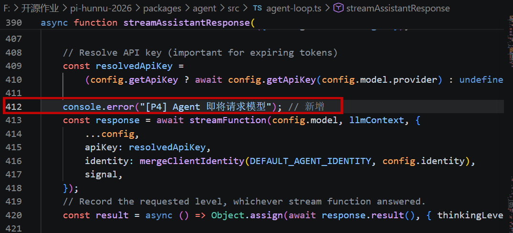

**S1**　模型调用日志。截图是在插入第二处日志前拍的，当时显示在第 412 行，两处都插入后移到第 413 行。

在 `runLoop` 中，将工具日志放在 `for (const result of toolResults)` 内，紧跟 `currentContext.messages.push(result)`。每写入一条工具结果，终端就打印一次。

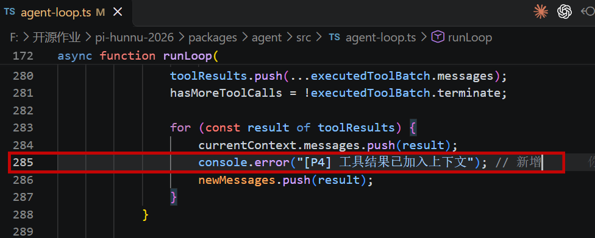

**S2**　工具结果日志，修改后的第 285 行。

两处都使用 `console.error` 向标准错误流输出观察日志。模型日志只表明执行到了调用位置，是否成功收到回复还要看交互结果。

### 任务 2 重新编译并启动

最初执行 `npm run build` 时，`packages/ai` 的 `generate-models` 在连接 `models.dev` 时超时。再次尝试时，构建遇到过模型目录响应正文下载超时，也遇到过 `radius.pi.dev` 响应头超时。终端还打印了 `min-release-age-exclude` 的 npm 警告，最终构建成功时仍能看到这条警告。

排查时沿用上次实验的 PowerShell 代理配置思路，由 `HTTP_PROXY`、`HTTPS_PROXY` 指向本机代理，再设置 `NODE_USE_ENV_PROXY=1`，让构建中发起请求的 Node.js 进程读取代理设置。模型目录需要下载完整才能供生成脚本读取，单独看到 HTTP 200 只能确认已收到响应头。

最终在 Pi 源码根目录完成了在线构建。打包结束后，PowerShell 返回提示符，紧接着查询的退出码为 `0`。

```powershell
npm run build
$LASTEXITCODE
```

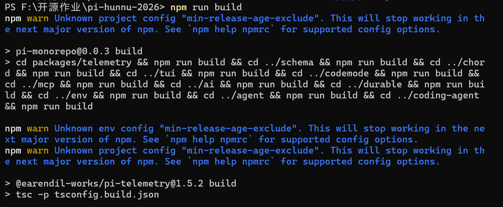

**S3a**　从 `F:\开源作业\pi-hunnu-2026` 执行 `npm run build`。

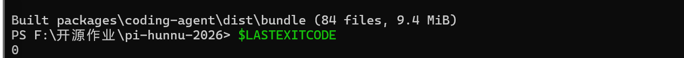

**S3b**　`packages\coding-agent\dist\bundle` 打包结束，共 84 个文件、9.4 MiB，`$LASTEXITCODE` 输出 `0`。

随后从同一目录启动本次编译的 CLI。交互界面显示 Pi `v1.5.2` 和所选模型 `deepseek-v4-pro`。

```powershell
node .\packages\coding-agent\dist\cli.js
```

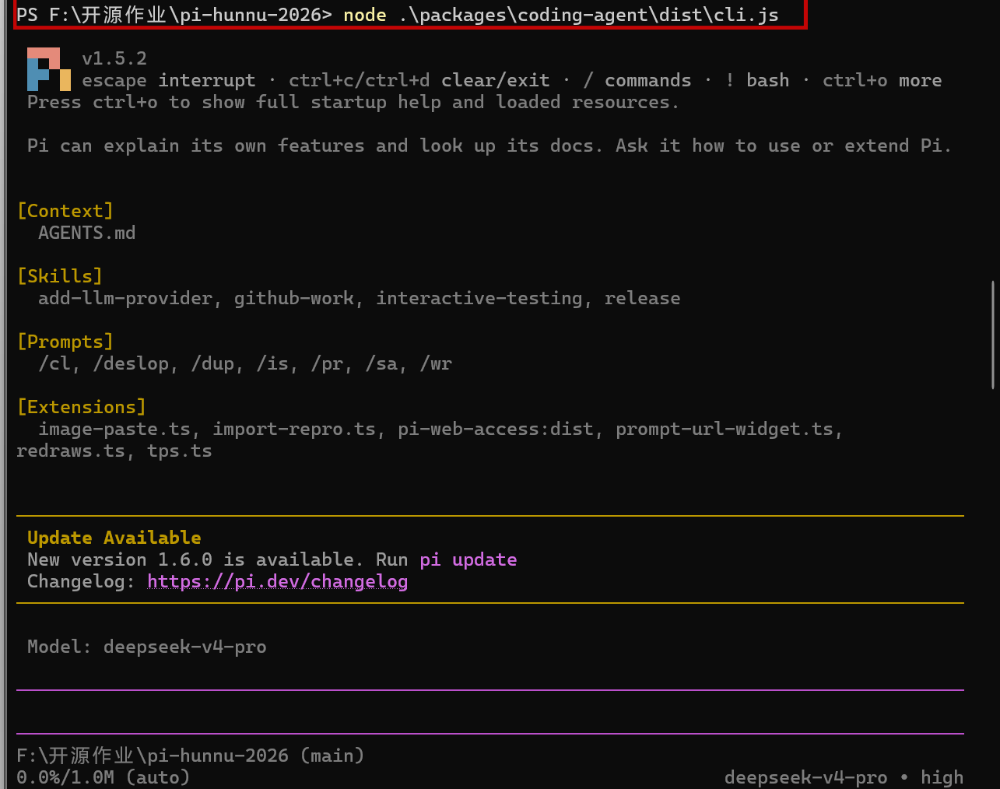

**S4**　启动命令及 Pi 交互界面。

### 任务 3 对比两次会话

在 Pi 源码根目录创建 `practice4.txt`，写入一行 `实验代号：1001dx`。启动 Pi 后在新会话 A 中直接提问，再用 `/new` 开始会话 B。两次使用同一个模型 `deepseek-v4-pro`，B 的指令只提供文件名，代号留在文件里。

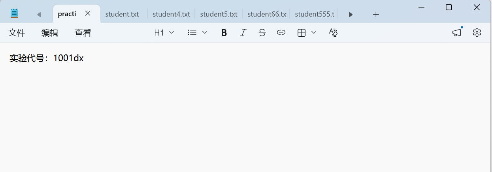

| 观察项 | 会话 A | 会话 B |
| --- | --- | --- |
| 工具执行 | 无 | `read` 执行 1 次 |
| 截图可见的 `[P4]` 日志 | 请求模型（S5） | 请求模型 → 工具结果加入上下文 → 再次请求模型（S6b） |
| 进入模型调用 | 1 轮 | 2 轮 |
| 最终回复 | 一句话解释 Git 分支 | 返回代号 `1001dx` |

#### 会话 A 直接问答

**输入**　请直接用一句话解释什么是 Git 分支。

**最终回复**　Git 分支是一条独立于主线、可并行推进开发并在需要时合并回主线的提交记录线。

没有执行工具。S5 中只有一条 `[P4]` 日志，对应一轮模型调用。

```text
[P4] Agent 即将请求模型
```

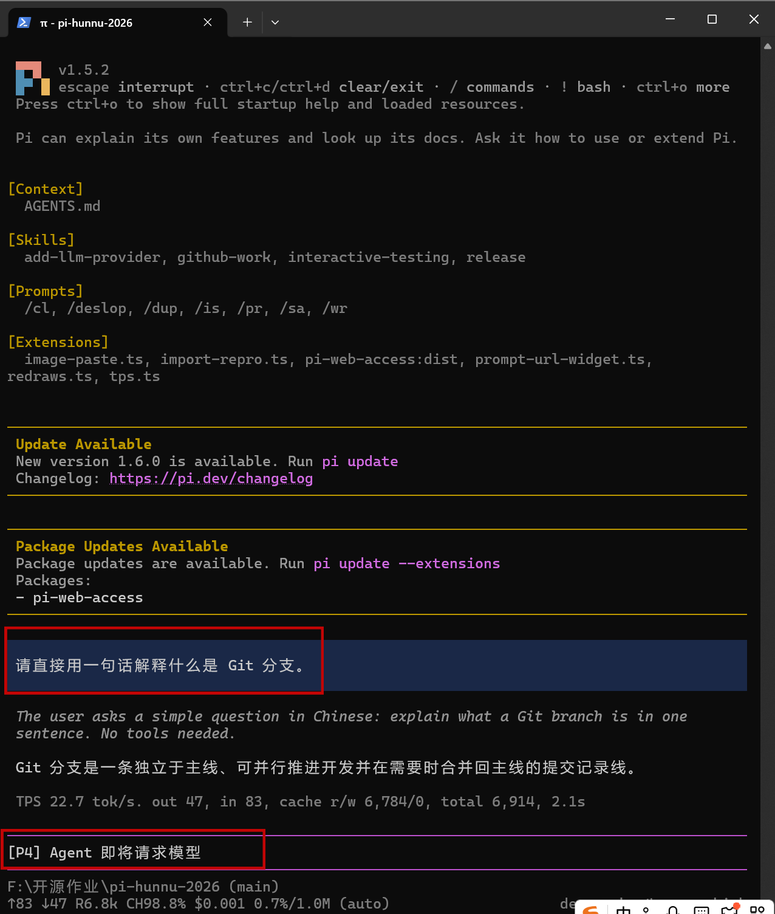

**S5**　直接问答的运行记录。

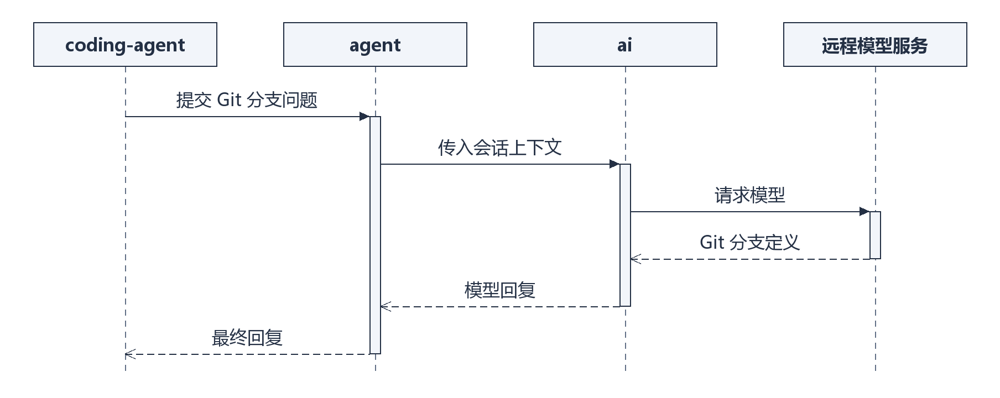

**图 1**　会话 A：直接问答。 [draw.io 源图](../images/session-a.drawio)

#### 会话 B 读取文件

**输入**　请用 read 工具读取当前目录的 practice4.txt，并告诉我文件中的实验代号

**最终回复**　文件中的实验代号是：`1001dx`

S6a 记录了一次对项目根目录 `practice4.txt` 的 `read` 调用，回复中的代号和文件内容相符。交互画面只保留了后两条日志，所以用同一条指令复测，并把标准错误流保存到文件。退出 Pi 后按 UTF-8 读取，S6b 记录了这次复测的三条日志。

```text
[P4] Agent 即将请求模型
[P4] 工具结果已加入上下文
[P4] Agent 即将请求模型
```

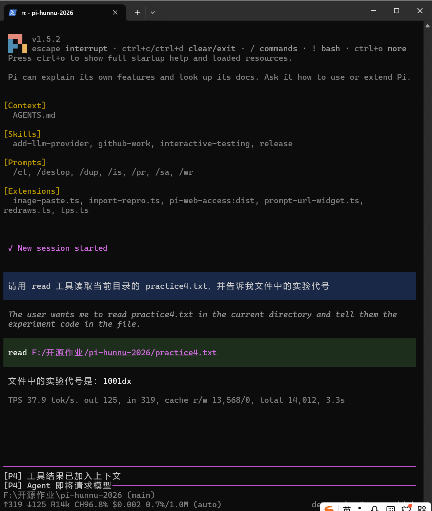

**S6a**　原会话的输入、`read` 调用和最终回复。

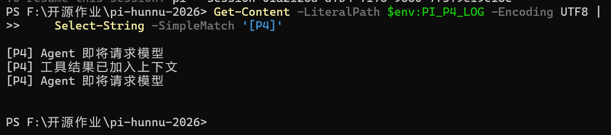

**S6b**　使用同一指令复测时从日志文件读取的三条 `[P4]` 记录。

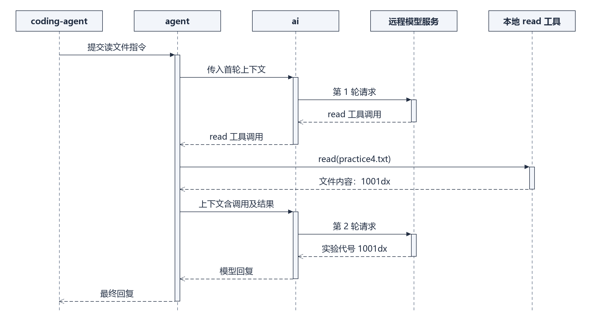

**图 2**　会话 B：读取本地文件。 [draw.io 源图](../images/session-b.drawio)

## 三、任务书问题作答

### 两次会话分别进入了几轮模型调用

**会话 A 进入了 1 轮模型调用。** S5 有一条 `[P4] Agent 即将请求模型`。这轮模型收到 Git 分支问题后直接给出最终回复，期间没有调用工具，也没有产生工具结果。

**会话 B 进入了 2 轮模型调用。** 第 1 轮返回对 `practice4.txt` 的 `read` 调用。Agent 在本地执行这次读取，将结果写入上下文。第 2 轮带着这个结果发出请求，模型返回 `1001dx`，会话结束。S6a 显示本地工具调用和最终回复，S6b 的复测日志中两条「Agent 即将请求模型」分别对应这两轮。

模型调用轮数按进入 `streamFunction` 的次数计，「工具结果已加入上下文」标记的是两轮之间的一次上下文更新。

### 谁实际读取了文件

实际读取 `practice4.txt` 的是本地 Pi 进程中运行的 `read` 工具。第一轮模型回复给出工具名和文件路径，`agent` 循环识别这次工具调用，执行 `coding-agent` 提供的工具。工具根据工作目录解析路径，通过 Node.js 文件系统接口读取内容，再把文本交回 Agent。远程模型收到的是本地 Pi 随下一轮请求发回的工具结果。

### 下一轮模型请求多带了什么

相较首轮，第二轮上下文保留原有消息，并多了**上一轮助手发出的 `read` 调用**和**对应的 `toolResult` 消息**。调用记录说明要读哪个文件，结果消息携带读出的文本 `实验代号：1001dx`，并通过工具调用 ID 与该次调用对应。源码先将工具结果加入 `currentContext.messages`，再在下一轮把更新后的消息转换成模型使用的上下文，交由 `ai` 层向远程模型发起请求。这样第二轮就能根据实际读出的内容回复.

## 四、实验总结

两次会话都只提交了一条用户指令，但进入模型调用的次数不同。直接问答在第一轮就得到最终回复。读文件时，第一轮模型决定调用哪个工具，本地 Pi 执行读取，把结果加入上下文，再由第二轮模型根据文件内容作答。S6b 的三条日志把这两轮请求和中间的上下文更新记录了下来。
